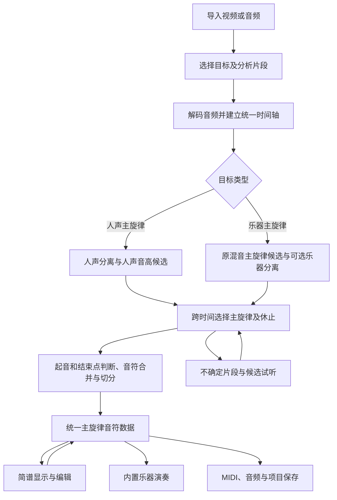

# NoteFlow 主旋律识别与简谱演奏重构方案

日期：2026-11-13。状态：需求已确认，技术路线待真实素材验证。

本轮范围：重新定义产品和技术方案；不修改、删除现有业务代码。

本文依据本次需求沟通、公开项目文档和论文形成。没有对现有实现做代码诊断，也没有运行候选模型。文中的原因分析是待验证假设，性能和质量指标是拟定验收目标，均不代表已经达到的结果。

## 1. 建议先做什么

**建议保留现有项目作为对照，独立重做识别核心，先证明主旋律演奏明显更像，再接入桌面界面。**

产品的核心目标应当是：

> 导入视频或音频，选择要提取的人声或乐器主旋律，自动生成一份可编辑简谱；点击演奏，用内置乐器准确、连贯地重现这条旋律。

这意味着成功标准是“旋律听起来对”，而不只是“检测出很多音符”“生成了 MIDI”或“谱面看上去完整”。

具体决策：

1. **主旋律选择必须是独立能力。** 分离人声、钢琴或其他乐器之后，仍可能有和声、伴奏和多个声部，需要继续挑出目标旋律。
2. **识别、节奏整理和演奏分别验证。** 音高准确也可能因为切音错误而难听；播放顺滑也可能只是把错误音符连起来。
3. **产品只保留一份结果。** 简谱是这份旋律的显示方式，演奏是它的发声方式，无需让用户在“简谱”和“旋律”两个结果之间选择。
4. **保留原始演奏时间。** 排谱所需的节拍规整不能破坏原曲的停顿、切分、同音反复和速度变化。
5. **先采用已有模型组合，不从零训练大模型。** 模型选择以本项目素材的对比结果为依据；需要补足的核心是声部选择、时间连续解码、音符切分和质量判断。
6. **默认自动处理，困难处允许少量选择。** 系统拿不准时提供局部候选试听，不能用一串似是而非的音符假装成功。

## 2. 已确认的需求和边界

| 项目 | 已确认要求 |
| --- | --- |
| 素材 | 视频、音频；纯音乐／背景音乐和带人声歌曲都需要 |
| 目标选择 | 导入时选择“人声主旋律”或“乐器主旋律” |
| 相似度 | 用单一乐器弹出主旋律，音高、节奏、连贯性尽量接近原声 |
| 演奏方式 | 首版使用软件内置乐器 |
| 平台 | 首版 Windows，优先针对 NVIDIA 显卡优化 |
| 运行方式 | 本地默认为主，云端可选 |
| 当前交付 | 先给出方案文档，再决定如何实施 |

首版以一条主要旋律线为输出，不以复原完整编曲、所有伴奏和原唱音色为目标。主旋律本身由多个乐器接力时，应允许在乐句边界切换来源；不能把“单条旋律”理解为“整首只能来自一个乐器”。

“很像”需要拆开衡量：音符是否选对、绝对音高是否对、进入和结束时间是否对、乐句是否连贯。换成钢琴以后音色自然不同，不能用原始波形相似度衡量这件事。

对没有明确主旋律的氛围音乐、密集对位、齐奏叠八度或严重遮挡片段，首版应显示不确定性，不承诺任意素材都能一次完全正确。

## 3. 对现有问题的重新判断

下面是基于用户听感的排查假设，实施时必须用中间结果验证，不能直接当作现有代码的问题结论。

| 用户感受到的问题 | 可能原因 | 必须检查的证据 | 对应改造 |
| --- | --- | --- | --- |
| 主旋律和背景混在一起 | 对混音直接取音高；把所有音符都留下；只取最高音或最大能量音 | 原声、分离声部、候选音高和最终旋律的逐段对照 | 声源候选＋跨时间的旋律选择 |
| 演奏断断续续 | 低置信帧直接当休止；同一长音被切碎；短音被误删；播放调度不稳 | 连续音高曲线、音符起止时间、实际渲染音频 | 连续解码、起音判断、正确合并、稳定渲染 |
| 听起来跑调 | 跟到伴奏或泛音；八度错；调号转换错；强行吸附到某个调 | 绝对音高、八度、简谱回转音高、调律偏移 | 保留绝对音高；纠正泛音误判；调性只作弱约束 |
| 音高似乎对但不像 | 节奏量化过重；休止缺失；同音反复被合并；重音消失 | 原声与钢琴重放的同步 A/B | 保留演奏时间、起音和力度变化 |
| 分离后效果反而变差 | 分离漏音、残留、相位或瞬态伪影 | 同一模型在原混音与分离输入上的对照 | 原声旁路、候选择优，避免强制分离 |
| “简谱”和“旋律”听不出区别 | 两个入口实际播放同一组音符，或差异不构成独立需求 | 两者输出的音高、起止时间和音色是否一致 | 统一结果和演奏入口 |

最容易误判的两点：

- **钢琴分轨不等于钢琴主旋律。** 右手和弦、左手伴奏仍然可能同时存在；分离模型无法仅凭“这都是钢琴”知道用户要哪条线。
- **单音高追踪器不等于主旋律识别器。** 多个声部同时存在时，它可能稳定地追踪错误声部；“很稳定”不能证明“选对了”。

## 4. 简谱与旋律：界面统一，数据保留必要细节

你的判断在产品层面成立：如果音高、时长、节奏和音色相同，叫“简谱播放”还是“旋律播放”，听起来都应相同，没有必要人为拆成两个功能。

内部仍然存在三个层次，但都属于同一份作品：

| 层次 | 保存什么 | 用途 |
| --- | --- | --- |
| 声学证据 | 每帧候选音高、置信度、起音、声部来源 | 判断识别是否可靠，支持局部重算 |
| 主旋律音符 | 绝对音高、原始起止时间、力度、乐句、用户修改 | 演奏和导出的共同依据 |
| 简谱视图 | 调号、数字、八度点、时值、休止、小节、连音线 | 让人读谱、编辑和打印 |

**例子一：音高不能只保存数字。** 同一个“5”，在 `1=C` 和 `1=G` 中对应不同的实际音高。系统应以绝对音高为准，再计算显示哪个数字；只换记谱调号时不应偷偷改变声音，真正移调需明确执行“移调”。

**例子二：整齐的谱不等于机械的时间。** 两个音在 0.00 秒和 0.47 秒进入，谱面可能显示为两个规则的时值；默认演奏仍保留 0.47 秒这个进入时间。若将其强行改为 0.50 秒，连续多个音就可能失去原来的节奏感。

**例子三：颤音不等于一串碎音。** 人声在一个音附近的连续起伏应作为该音的表现细节。钢琴回放以稳定音高表达，不能把每次细小起伏都生成一个新琴键。真正的快速装饰音、交替颤音则应依据起音和稳定音高变化保留。

数据规则：

- 一个稳定的音符 ID 对应演奏事件，谱面元素引用该 ID；跨小节延音可以对应多个符号，但仍是一次持续发声。
- 简谱编辑修改统一音符数据，再更新演奏缓存。用户对某个片段的修改应锁定，局部重识别不能悄悄覆盖。
- 记谱时值由节拍映射生成，原始时间单独保留；高级选项可以提供“严格按谱节奏”，不增加第二套识别结果。
- 默认保持原调、原八度。超出某种音色合适音域时提示或换音色，不能静默压到另一个八度。

## 5. 推荐的整体流程

本地和云端使用同一套输入输出约定。云端改变运行位置或候选模型，不改变作品的数据格式，也不产生另一份互不一致的谱。

### 5.1 导入和预处理：先保证时间轴正确

采用 FFmpeg 作为媒体解码候选，读取视频音轨和常见音频格式；多音轨视频需要让用户知道正在使用哪条音轨。具体可支持的编码由实际打包的构建决定，首版至少验证 MP4、MKV、WAV、MP3、FLAC、M4A 的代表性文件。[FFmpeg 官方文档](https://ffmpeg.org/ffmpeg.html)

处理原则：

- 保留原始音频供试听；按各模型要求生成重采样副本，不把一种采样率强加给所有模型。
- 分离阶段尽量保留立体声；需要单声道的模型另行生成输入，避免反相声道相加后丢失主旋律。
- 优先允许分析 15～60 秒的选段，再处理整首，减少反复试错的等待。
- 切段保留上下文和重叠区，拼接时去重，并允许长音跨越边界；全曲分析不能把每个小段当作完全独立的歌曲。
- 统一处理音频起始偏移、裁剪偏移、重采样时间、模型填充和分离延迟，保证原声、谱面和回放对齐。
- 不默认重度降噪、压缩或改变速度；每一步处理都可能损伤后续需要的起音和谐波信息。

视频中的对白不是演唱。如果选择提取背景音乐，应尽可能抑制对白／音效，但不能简单把所有人声都当作歌曲主旋律。对此单独设置验收样本。

### 5.2 两种目标采用不同的候选生成方式

**人声主旋律路线：**

优先验证“人声分离 → 人声音高估计 → 主唱线选择”。分离模型使用经过验证的人声权重；RMVPE 作为人声音高候选，torchcrepe 作为另一基线。RMVPE 的原始任务明确针对复调音乐中的人声音高，不据此推断它对所有乐器也一样有效。[RMVPE 官方项目](https://github.com/Dream-High/RMVPE)

人声分轨内仍可能包含和声、合唱和叠唱。存在多条竞争旋律时，需要选择主唱，并允许用户在局部试听候选。歌曲间奏没有主唱时，默认保留休止；是否补入乐器间奏可提供后续可选项，不能未经说明切换目标。

**乐器主旋律路线：**

同时保留两种待比较的入口：

1. 在原混音上生成主旋律音高候选，保留旋律上下文。
2. 当能可靠定位乐器时，分离目标乐器或减少人声、鼓、低音干扰，再生成候选。

主旋律估计可用 Essentia 的 PredominantMelody 作为传统基线，它的任务本身就是复调音乐主旋律估计；不能将其视为已经达到本项目质量要求。[Essentia 算法说明](https://essentia.upf.edu/reference/std_PredominantMelody.html)

在较干净的单声部上比较 torchcrepe；在包含和弦的单乐器输入上比较 Basic Pitch；对钢琴独奏，可加钢琴专用转录模型。所有复调结果都还要经过主旋律选择，不直接把检测到的所有音符用钢琴播放。[Basic Pitch 官方项目](https://github.com/spotify/basic-pitch)、[钢琴转录项目](https://github.com/bytedance/piano_transcription)

不默认每首运行所有模型。原型阶段先比较，量产路线再根据素材类别和低置信片段选择必要的模型，控制耗时与显存。

### 5.3 主旋律选择：解决“跟错了谁”

建议建立“候选音高／音符 → 乐句轨迹”的全局或分乐句解码，而不是逐帧独立选一个最大值。

每个时间位置保留多个候选，并加入明确的“当前无目标旋律”状态。路径评分综合：

- 候选的声学支持和可信度。
- 相邻时刻的音高连续性，以及是否有起音支持真正的跳进。
- 声部／音色的一致性，减少在伴奏和旋律之间来回跳动。
- 乐句内的走向、起止和持续性。
- 节奏性伴奏的重复模式，作为辅助证据而非绝对排除条件。
- 旋律缺席的证据，避免用伴奏填满本来应该安静的地方。

优先试用动态规划／Viterbi 一类序列解码。连续性惩罚只能是软约束，不能为了平滑而抹掉真正的大跳；调性也只能是弱提示，不能强行删除半音、变化音或转调。

torchcrepe 的实现已经提供 Viterbi 解码以减少倍频／半频跳动，但它解决的是音高轨迹的一部分问题，不能替代“哪个声部是主角”的判断。[torchcrepe 官方说明](https://github.com/maxrmorrison/torchcrepe)

拟保留最好的 2～3 条局部候选。只有当候选分数接近或声部归属不明确时，才显示“试听 A／B，选择你想要的旋律”。置信度先作内部排序和风险标记，未经校准不能显示成“准确率 97%”。

### 5.4 从音高到音符：解决“切得太碎”

音符边界要同时参考音高稳定段、起音强度、能量变化和声部可信度。

| 情形 | 建议处理 |
| --- | --- |
| 同一音高持续，中间短暂低置信 | 仅在前后音高一致、无新起音且能量支持时补接 |
| 同一音高被真正重新弹奏 | 依据新的起音切成两个音，不能直接合并 |
| 颤音造成小幅音高摆动 | 估计中心音高，保留表现信息，不生成一串碎音 |
| 真正短促装饰音 | 起音和声学证据足够就保留，不能统一删除短音 |
| 演奏中的真实停顿 | 保留休止，不能靠拉长前一个音覆盖 |
| 泛音短时压过基音 | 比较谐波关系和上下文，检查是否为八度误判 |
| 分析窗口交界处 | 重叠对齐、合并同一事件，避免重复音或截断 |

开音与关音使用不同阈值，减少阈值附近反复开关。补接间隙、最短稳定段等参数随速度和素材调整，不先定一个“所有小于 100 毫秒的音都删除”的硬规则。

音高轨迹平滑、音符合并和回放连奏分别做消融对比，确认改善来自正确的环节，而不是副作用碰巧掩盖错误。

### 5.5 节奏与简谱：规整显示，不扭曲演奏

先保留秒级起止时间，再估计拍点和速度变化，并由此映射到拍数。拍号、调号和小节线不确定时允许手动修正，不能为了生成完整谱面强行认定整首固定速度、固定四四拍。

首版简谱必须表达数字、八度点、升降记号、休止、附点、连音线和基本时值；量化要能保留切分和三连音。调号变化或复杂自由速度可先标为待修正，播放仍以有效的演奏时间为准。

音高修正与调号设置分开：不能先猜出 C 大调，再把不在白键上的正确音强行改成邻近白键。全曲调律偏离标准音高时，记录调律偏移；钢琴默认落到稳定的半音音高，后续可提供整体调律设置。

### 5.6 内置演奏：让正确的音符正确发声

首选验证 FluidSynth＋明确可分发的 SoundFont，先把钢琴做好，再增加笛子、弦乐等音色。FluidSynth 能以 SoundFont 合成 MIDI 事件，但音色包本身需要另行选择和试听。[FluidSynth 官方项目](https://github.com/FluidSynth/fluidsynth)

关键规则：

- 用同一份音符数据生成演奏，不从简谱图片或显示文本重新解析音乐。
- 优先将结果离线渲染成连续音频供预览，播放过程中无需等待识别或逐音加载音色；修改后只重建必要的缓存。
- 需要实时合成时，按音频时间安排事件，不用界面定时器或逐音 sleep 控制节奏。
- 保留力度、乐句和实际音长；钢琴同音反复需要新的起音，持续音色需要正确的延音和释放。
- 延长音符、踏板和混响不能用来掩盖识别断裂。钢琴自身衰减也不等于识别漏音。
- 默认播放不随机增加“人性化抖动”；已有原声时间信息时，应保留它。
- 原声和演奏支持同一时间段循环 A/B、音量匹配及定位，避免更响的版本被误认为更准确。

连续滑音和颤音无法由普通钢琴完全复现。首版首先保证中心音高与节奏；适合滑音的音色和弯音表现可在此基础上扩展。

## 6. 公开项目如何借鉴

以下是分工与候选，不是“安装后就能达到高准确率”的承诺。研究结果、仓库演示和维护状态不能替代本项目的盲听及测量。

| 项目 | 建议借鉴内容 | 能力边界和本项目决策 |
| --- | --- | --- |
| [Basic Pitch](https://github.com/spotify/basic-pitch) | 音频到音符、起音／持续信息、弯音 | 官方明确更适合一次一个乐器。适合单乐器候选转录，不承担混音中的主旋律选择。代码 Apache-2.0 |
| [Demucs](https://github.com/facebookresearch/demucs) | 常见声部分离基线 | 原 Meta 仓库已归档；六声部模型的钢琴输出官方也提示有问题。可以固定版本做基线，不作为万能主旋律方案 |
| [MSST](https://github.com/ZFTurbo/Music-Source-Separation-Training) | 比较 BS-RoFormer／Mel-Band RoFormer 等分离模型，统一推理方式 | 架构名称不代表已经有适合目标乐器的权重；先验证具体检查点。代码许可与下载权重分开记录 |
| [torchcrepe](https://github.com/maxrmorrison/torchcrepe) | 连续音高、可信度、序列解码 | 用于较干净的单声部基线；不直接把混音中得到的单条曲线认作主旋律 |
| [RMVPE](https://github.com/Dream-High/RMVPE) | 复调环境下的人声音高估计 | 用于人声分支候选；实际推理实现、权重来源和许可还要落实 |
| [Essentia PredominantMelody](https://essentia.upf.edu/reference/std_PredominantMelody.html) | 主旋律显著性和音高轮廓基线 | 与任务直接相关，但准确度、Windows 集成要实测；库使用 [AGPLv3](https://github.com/MTG/essentia/blob/master/COPYING.txt) |
| [高精度钢琴转录](https://github.com/bytedance/piano_transcription) | 钢琴音符起止与踏板建模 | 对钢琴独奏有针对性；输出仍含伴奏，需要再选主旋律；钢琴数据集成绩不外推到配乐 |
| [YourMT3+](https://github.com/mimbres/YourMT3)／[MT3](https://github.com/magenta/mt3) | 多乐器音符与轨道候选 | 作为复杂混音的对照路线，仍需选主旋律。YourMT3 入口仓库并非完整即用安装包，需沿官方代码链接核实；不把它作为首版唯一依赖 |
| [SAM Audio](https://github.com/facebookresearch/sam-audio) | 用文本或时间提示定位目标声音 | 可探索困难片段的乐器分离。官方建议 CUDA GPU、权重需申请访问，使用专门的 SAM License；先作增强实验，不能假定提示“主旋律”就会准确输出 |
| [Muse](https://github.com/mqtik/muse) | 桌面壳与独立推理流程、原声与转录试听的产品组织 | 借鉴工程结构，不直接接收其准确度宣传或依赖选型；它的多轨目标与本项目单条主旋律并不相同 |
| [FluidSynth](https://github.com/FluidSynth/fluidsynth) | 内置乐器合成与 MIDI 播放 | 合成引擎不修正识别错误；音色和播放调度另行验收 |

另一个容易混淆的项目是 MELODIA Vamp 插件。它与相关算法思想值得研究，但官网说明该插件只供非商业使用，并非可自由修改和重新分发的软件；不能直接把插件当作桌面安装包依赖。[MELODIA 官方说明](https://www.upf.edu/web/mtg/melodia/)

进入实施时，只为最终入选的代码、权重和音色记录版本、来源、许可和文件校验值。本文没有完成任何模型的打包许可确认。

### 首轮验证配方

不要先把上表所有东西接进应用。先做下面四组可复现比较：

| 编号 | 处理路线 | 要回答的问题 |
| --- | --- | --- |
| V1 | 已验证的人声分离权重＋RMVPE／torchcrepe＋统一音符解码 | 主唱是否准确，长音和同音反复是否可靠 |
| I1 | 原混音的主旋律轮廓基线＋统一音符解码 | 不分离时能达到什么程度，是否避免了分离损伤 |
| I2 | 可选声部分离＋Basic Pitch／单声部音高候选＋旋律选择 | 分离是否真的改善目标乐器主旋律，而非只改善试听干净程度 |
| I3 | 可部署的多乐器转录候选＋旋律选择 | 对密集混音的改善是否值得额外耗时和集成成本 |

先完成 V1、I1、I2，I3 只在复杂配乐表现不够时引入。每组共用下游音符规则和同一种钢琴，减少比较中的干扰变量。最终允许人声和乐器选用不同路线，不追求一个模型包办全部。

## 7. 桌面、本地和云端的架构建议

若独立重做，优先考虑 Python 推理核心＋PySide6 桌面界面，降低模型集成与调试成本。PySide6 是 Qt 的官方 Python 绑定；这只是候选技术选型，现有桌面壳若合适可继续使用，不需要为了换框架重写界面。[Qt for Python 官方文档](https://doc.qt.io/qtforpython-6/)

建议拆为以下职责：

| 模块 | 职责 |
| --- | --- |
| 媒体输入 | 音轨选择、解码、裁剪、统一时间轴 |
| 分析任务 | 分段、模型选择、进度、取消、恢复和缓存 |
| 模型适配 | 本地模型及云端结果转成共同候选格式 |
| 旋律核心 | 声部选择、音符解码、置信度、用户修订 |
| 乐谱 | 调号与节拍映射、简谱显示和导出 |
| 演奏 | 内置音色、渲染、试听和音频导出 |
| 项目保存 | 素材引用、结果版本、修改记录、模型配置 |

**本地默认：**

- 模型推理放在独立工作进程，界面保持可操作，取消任务能停止后续计算。
- 优先支持 CUDA；首次下载模型后可离线运行。软件安装包与大型模型包分开管理。
- 避免同时加载多个大模型；按阶段加载、分块推理，并在显存不足时降低块长或提供替代路线。
- 缓存键包含素材内容、选段、目标类型、模型版本和参数。改变音色无需重新识别，改谱也不应重跑分离。
- 没有 NVIDIA GPU 时，提供能力说明或较慢的可用路线；具体支持范围必须经打包验证，当前不承诺 CPU 的速度或同等质量。

**云端可选：**

- 通过同一任务协议运行远程 GPU 推理，返回候选或统一音符数据；客户端继续编辑和演奏。
- 首版优先选一个可复现的自部署 GPU 服务作为实现目标。若采用第三方服务，先确认它是否提供音符／音高输出、时间信息和可靠接口，再替换后端。
- 本文未验证某个付费 API 已满足需求，因此不预设具体服务商、费用或效果提升幅度。
- 用户主动选择云端后才上传；显示服务地址、选段范围及已知费用。云端失败保留本地结果，可取消和重试，不静默上传整段视频。
- 云端的价值是可用算力与模型选择。把相同模型移到服务器上并不会自动提高识别准确率。

精确显卡型号、显存和内存暂未提供，不影响总体架构；在确定默认模型、最长片段和耗时目标前补齐。

## 8. 首版应该给用户什么

主流程尽量保持短：

1. 导入文件，选择“人声主旋律／乐器主旋律”，必要时框选片段。
2. 默认本地生成；需要时选择云端。
3. 看到同一份简谱，选择内置音色，点击“演奏”。
4. 在同一位置切换听原声和演奏，定位有疑问的片段。
5. 只在需要时修改音高、起止位置、合并／拆分音符，或换一个局部候选。
6. 保存项目，导出 MIDI、演奏 WAV 和简谱文件。

首版必须包含：原声／演奏同步定位、循环试听、低置信片段提示、基本修订、撤销、任务取消、保存和再次打开。否则自动识别只要错几个关键音，就很难得到真正可用的成品。

内置音色先保证钢琴与一种持续音色质量。连续音高诊断图、模型名称和阈值属于开发与高级设置，不占据默认操作流程。

游戏自动按键、外接 MIDI 演奏、多轨编曲编辑和原唱音色复刻均不进入首版范围；后续可以基于同一音符数据扩展。

## 9. 如何证明“听起来明显更像”

### 9.1 先建立真实素材集

建议第一轮收集 32 段、每段 15～30 秒：

| 类别 | 数量 | 覆盖问题 |
| --- | --- | --- |
| 清晰单声部 | 8 | 钢琴单旋律、笛子／弦乐、清唱，检查基本能力 |
| 主唱＋伴奏 | 8 | 和声、气声、颤音、强节奏、间奏留白 |
| 明确乐器主旋律＋伴奏 | 8 | 钢琴左右手、吉他、合成器、影视／游戏配乐 |
| 困难素材 | 8 | 对白覆盖、混响、旋律交接、密集和声、八度齐奏、无明确主旋律 |

优先包含用户此前觉得“不像”的片段。按整首来源划分调试集和保留集，例如 20 段调试、12 段保留；同一首歌的不同裁剪不能分到两边。测试集只用于最后比较，不能反复据此调参。

由人工确认每段要听的旋律，标注音高、起止和真实休止。歧义段允许多条合理参考，并记录主旋律选择；不能把标注者的唯一偏好当作客观真相。只用于本地验证的素材无需纳入代码仓库。

在真实素材之外，增加少量可知真值的音符合成样例，用于验证同音反复、跨段长音、休止、调号转换和时间对齐。这些样例能查程序错误，但不能代替真实音乐验收。

### 9.2 同时看音高、音符和听感

采用 mir_eval 的旋律及音符指标，统一评估口径。旋律评估中的原始音高准确率保留八度差异；仅看忽略八度的音级准确率，会漏掉明显的高低八度错误。[mir_eval 旋律评估实现](https://github.com/mir-evaluation/mir_eval/blob/main/mir_eval/melody.py)

| 指标 | 解决什么问题 |
| --- | --- |
| 原始音高准确率 RPA | 应有旋律的帧中，音高是否正确，八度错计错 |
| 整体准确率 OA、旋律漏检和误报 | 是否在该休止时乱弹、该出旋律时沉默 |
| 音高＋起音 F1 | 音符对不对，以及是否在正确时间进入 |
| 加入结束时间的音符 F1 | 音长是否正确，避免只看起音就漏掉断裂 |
| 八度错误与声部串入时长 | 是否跟到了泛音或伴奏 |
| 错误切分、同音反复保留、错误补接 | 是否因碎音或过度合并损伤连贯性 |
| 原声／统一钢琴盲听 | 能否辨认旋律，节奏与乐句是否自然 |
| 修正成本 | 30 秒片段要改多少处、花多长时间才能满意 |

音符匹配先采用公开工具常用口径：音高容差 50 cents、起音容差 50 毫秒；结束时间容差为参考音长的 20% 与 50 毫秒中的较大值。同时报告不计结束时间和计结束时间的 F1，避免短音被掩盖。[mir_eval 音符评估实现](https://github.com/mir-evaluation/mir_eval/blob/main/mir_eval/transcription.py)

不要以“识别音符总数更少”“曲线更平滑”“分离 SDR 更高”单独证明主旋律更准确。所有自动指标按素材类别报告，并保留失败片段，不能只展示总体平均数。

### 9.3 拟定首轮门槛

**下列数字是工程目标，尚未测得；达不到时应报告差距并调整路线，不写成既有能力。**

| 范围 | 初始目标 |
| --- | --- |
| 清晰单声部保留集 | RPA ≥ 95%，音高＋起音 F1 ≥ 0.90 |
| 明确主旋律混音保留集 | 人声与乐器分别报告：RPA ≥ 90%，音高＋起音 F1 ≥ 0.85，含结束时间 F1 ≥ 0.75 |
| 连贯性 | 同时报告碎音率与错误合并率；明显长音断裂、同音反复丢失不得以平滑度提升抵消 |
| 困难素材 | 单独报告成功／失败；不混入简单样本平均值宣称整体高准确率 |
| 主观听感 | 明确主旋律片段中，至少 80% 被评为“容易辨认，基本保持原旋律”；新方案明显优于旧方案 |
| 播放完整性 | 连续试听无引擎断音、爆音、音符卡住或时间逐渐漂移 |

听感评分建议 1～5 分：1＝不像，2＝仅部分相似，3＝能辨认但多处明显错误，4＝容易辨认且基本准确，5＝只有少量细节差异。以 ≥4 分计主观通过。先由用户试听；条件允许再增加 2～3 位听者，随机化版本标签和播放顺序。

对旧版和新版使用相同片段、钢琴音色与音量，隐藏版本标签。另加入人工修正后的参考音符回放，帮助区分“钢琴音色本来就不同”和“转录确实错了”。主观结果记录样本数，不能把小规模试验解释为所有音乐的准确率。

速度和内存先测量，不先写“几秒完成”。至少记录冷启动、首次模型下载、热启动分析时间、峰值内存／显存、渲染时间，以及 `分析耗时 ÷ 素材时长`。在确定目标显卡后，再定可接受的产品等待时间。

## 10. 如何改造，什么时候才需要重写或删除

### 阶段 A：建立比较依据

交付素材清单、标注、旧版输出、统一钢琴回放和评价脚本。将主旋律选择错误与音高、节奏、播放错误分别记录。

通过条件：可以对同一段音频定位“到底是哪一步变错”，且比较能复现。

### 阶段 B：独立验证新识别核心

实现 V1、I1、I2 的实验管线，不先接完整界面。输出候选音高、最终音符、低置信片段、MIDI 和统一回放。逐项比较是否分离、是否做序列解码、是否做音符边界修正。

通过条件：清晰和明确主旋律场景达到拟定门槛，用户能听出明显改善；失败例明确归因。若仍然不像，继续修改模型或旋律选择策略，不急着换界面。

### 阶段 C：统一作品数据和演奏

实现统一音符模型、时间映射、简谱、内置音色、缓存及局部编辑。验证改谱后的声音与谱面一致。

通过条件：无两套结果不一致；移调／调号、休止、连音、同音反复、跨段长音和保存重开均正确。

### 阶段 D：接入 Windows 应用

在新核心接口明确后检查旧项目模块，逐项决定复用或替换；完成模型下载、GPU 检测、取消、进度和安装包验证。

通过条件：目标 Windows 设备上能完整走通导入、识别、试听、修改、保存、导出，并且重任务不冻结界面。

### 阶段 E：接入可选云端并清理旧链路

接入一个实际可运行的远程后端，验证显式上传、取消、失败恢复和结果兼容。新旧路线完成保留集回归后，再退出重复实现。

通过条件：本地与云端结果都能被同一作品格式编辑、播放；本地默认行为保持明确，旧代码清理有可恢复版本。

### 复用／替换的判断表

| 类别 | 建议 |
| --- | --- |
| 媒体导入、文件管理、基础窗口、已有可用音频播放 | 通过接口和实际质量检查后优先复用 |
| 混音直接转成单音、逐帧硬切、只取最高音等逻辑 | 若现有实现确实采用且验证失败，替换为新核心 |
| 简谱与旋律各自维护音符数据 | 若存在，迁移为统一数据模型 |
| 一次性实验脚本、重复模型适配和旧参数分支 | 待新路线稳定后归档或移除 |
| 用户素材、项目文件、有效对照输出 | 保留，不因重构清理而删除 |

当前尚未审查旧代码，所以不能给出真实的无用文件删除清单。下一阶段按接口边界评估：如果桌面壳和数据层容易接入，做核心替换；只有数据、界面和算法紧密耦合且迁移成本更高时，才重建应用主体。

不需要先清空仓库。保留现有可运行版本作为效果和回退依据，新核心通过验收后再删除被证明多余的实现。

## 11. 实施前还需补齐的信息

核心产品方向已经确认。以下信息影响模型选择和验收安排，但不阻止本方案成立：

| 信息 | 为什么需要 | 最晚补齐时点 |
| --- | --- | --- |
| 常用 NVIDIA 显卡型号、显存、系统内存 | 决定默认模型、分块大小和耗时目标 | 模型验证开始前 |
| 5～10 个代表性素材及想提取的时间段 | 防止优化到与实际使用不同的音乐类型 | 建立素材集时 |
| 最常见的失败例、希望保留的具体旋律 | 判断是声部偏好、识别错误还是演奏表达问题 | 人工标注时 |
| 可接受等待时间、云端费用和部署方式 | 决定远程推理规模及是否接第三方服务 | 云端实施前 |

下一步最有价值的交付应是：**同一批素材的原声、旧版钢琴、新版钢琴和差异报告。** 先用听感和测量证明路线有效，再投入完整应用改造。
